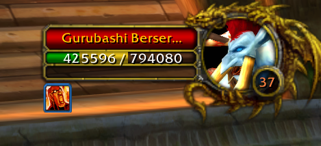
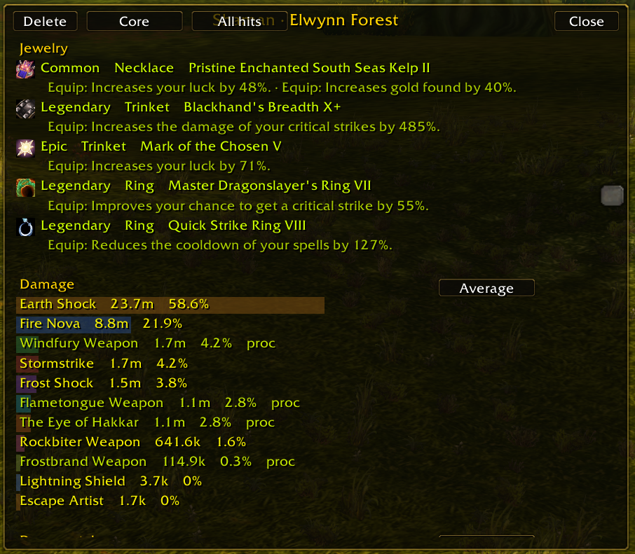

# Azeroth Survivors addons

Core Comforts and Run History are addons for [Azeroth Survivors](https://azerothsurvivors.app/).

## Core Comforts

Boss and guardian health bars, with debuffs and an estimate of damage over time. The same estimate is drawn on the target frame. Guardian timers, and minimap pins for guardians and caches. The action bar shows the seconds left on each spell. Character stats can show more decimal places. Every option can be turned on or off. `/cc` opens the window.

### Direction arrows, tally, and jewelry

Direction arrows for a cache and a guardian. Kill count, gold, and caches. The cache number turns green when you can afford one and red when you cannot. The number in parentheses is how many caches you can afford right now. Equipped jewelry is shown above the bar.

<table>
<tr>
<td width="50%" align="center" valign="top">
<h3>Minimap</h3>

Minimap icons for guardians and caches. A guardian shows as alive, in combat, or dead. A dead one shows a countdown when it is close to coming back. The icons scale with the minimap zoom.

</td>
<td width="50%" align="center" valign="top">
<h3>Boss list</h3>

Upcoming bosses, and the gear they drop. A mark shows whether you already own that piece, based on the armory collection in the addon.

<h3>Guardian timers</h3>

Each row shows whether that guardian is alive, in combat, or how long until it returns.

</td>
</tr>
<tr>
<td width="50%" align="center" valign="top">
<h3>Kills, experience, and gold per minute</h3>

Kills, experience, and gold per minute, and how many enemies are alive.

</td>
<td width="50%" align="center" valign="top">
<h3>Boss timer and health bars</h3>

Boss timer, drawn as a progress bar. Boss health bars with debuffs, and an estimate of the damage over time. The same estimate is drawn on the target's health bar.

</td>
</tr>
</table>

### Options

Each option can be turned on or off. Caches you can buy is under UI, just below kills, gold, and cache, and it starts on. Action bar cooldowns starts on: whole seconds left on each spell, yellow under 5 seconds and red under 1 second. Stat places, under Decimals, sets the decimal places on the character panel. It starts at the game's own rounding.

### Armory

Gear from each map and boss. It updates when you get a drop. The addon cannot read your current collection, but you can edit the collection and check the items you already owned before installing it. It also shows your total marks, and the marks collected this run.

## Run History

Saves each run and compares kills per minute by class, map, difficulty, and spec. New runs also store the date and time. `/history` opens the window. Options are in that window.

### Run list

Filter by class, map, and difficulty. Switch between endless, the full run, and a mid-run snapshot, and between the average pace and the last minute. Each new run shows its date and time. The minimum length hides shorter runs, from 0 to 16 minutes.

### Run details

Date and time, pace for the whole run and the last minute, kills, gold, and the highest hit.

### Spells, jewelry, and damage

Character stats. Spells, with the total upgrades for each one, and jewelry, with what the piece does while equipped. Damage done, and each ability's share of that damage.

### Damage taken and pickups

Damage taken, with each source's share, and pickups with the increase from that rank.

## What's new

Core Comforts 0.3. The action bar shows how many seconds are left on each spell. It turns yellow under 5 seconds and red under 1 second. Stat places sets how many decimal places the character panel uses. It starts at the game's own rounding.

Run History 0.3. Each new run stores the date and time. Options can show it as day/month or month/day, with or without the year. Details shows the total upgrades on each spell, and what each jewelry piece does while equipped. The pickup list shows the increase from that rank. Damage done includes each ability's share of the damage in that snapshot.

Endless and the full run are always saved. The first install also saves snapshots at 16, 18, and 20 minutes. You can change those in Options, up to 6 marks, from 1 to 60 minutes. A mark is saved only when a new run reaches that time.

Runs saved before this version stay in the list. They do not gain a date, upgrade lines, jewelry effects, or a damage share. A dash means that detail was not recorded.

## Install

On Windows and Linux, copy the `CoreComforts` folder, the `RunHistory` folder, or both into `benilla-config/AddOns/` next to the game. The addons load on the next world entry.

In the browser client, open Options, then AddOns, and install a zip of one addon folder. The zip should contain that folder itself (`CoreComforts` or `RunHistory`), not an extra parent folder.

Saved settings stay on your computer. They are not part of this repository.
