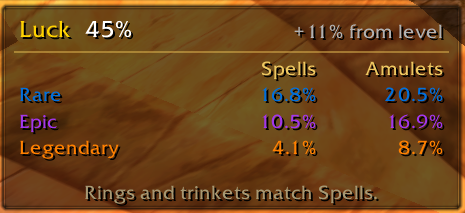
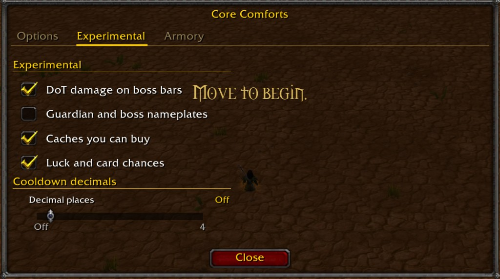

# Azeroth Survivors addons

Core Comforts and Run Stats are addons for [Azeroth Survivors](https://azerothsurvivors.app/). They run in the game's 1.12 client (`## Interface: 11200`).

## Core Comforts

Full target health, a kill, gold, and cache line, guardian timers, minimap pins and arrows, and spell cooldown decimals. The armory lists gear and set bonuses. `/cc` opens options. `/cc reset` parks the movable list.

Direction arrows for a cache and a guardian, the jewelry bar, and the kill, gold, and cache line.

Boss timer, boss health bars, and the debuffs on them.

Upcoming bosses, with the gear they drop. A check mark means that piece is already in the armory collection.

Kill, experience, and gold per minute, alive enemies, and guardian timers.

Luck, and the chance of rare, epic, and legendary spells and amulets.

The options window. Each piece can be turned off.

Experimental options, including cooldown decimals.

The armory. Gear is listed by rarity and slot, and each set bonus has its own tooltip. Checked pieces are ones you own.

## Run Stats

Saves each run and compares kills per minute by class, map, difficulty, and spec. `/stats` opens the window.

## Install

On Windows and Linux, copy the `CoreComforts` folder, the `RunStats` folder, or both into `benilla-config/AddOns/` next to the game. The addons load on the next world entry.

In the browser client, open Options, then AddOns, and install a zip of one addon folder. The zip should contain that folder itself (`CoreComforts` or `RunStats`), not an extra parent folder.

Saved settings stay on your computer. They are not part of this repository.
