# Azeroth Survivors addons

Core Comforts and Run History are addons for [Azeroth Survivors](https://azerothsurvivors.app/). They run in the game's 1.12 client (`## Interface: 11200`).

## Core Comforts

Boss and guardian health bars, with debuffs and an experimental highlight for estimated damage over time. Guardian timers, and minimap pins for guardians and caches. Every option can be turned on or off. `/cc` opens the window.

The armory lists your gear. For now it only tracks whether you have a piece or not. The addon cannot read your collection, so you can edit the collection and mark the items yourself. If a boss drops a piece during a run, the armory checks it off.

Direction arrows for a cache and a guardian. Kill count, gold, and caches. The cache number turns green when you can afford one and red when you cannot. The number in parentheses is how many caches you can afford right now. Equipped jewelry is shown above the bar.

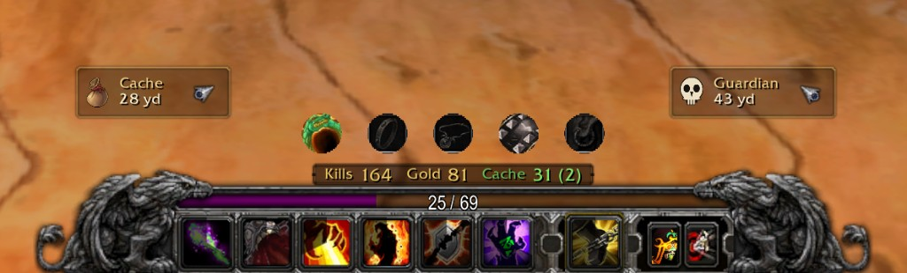

Minimap icons for guardians and caches. A guardian shows as alive, in combat, or dead. A dead one shows a countdown when it is close to coming back. The icons scale with the minimap zoom.

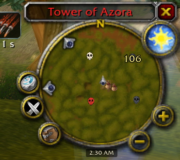

Boss timer, drawn as a progress bar. Boss health bars with debuffs, and an estimate of the damage over time.

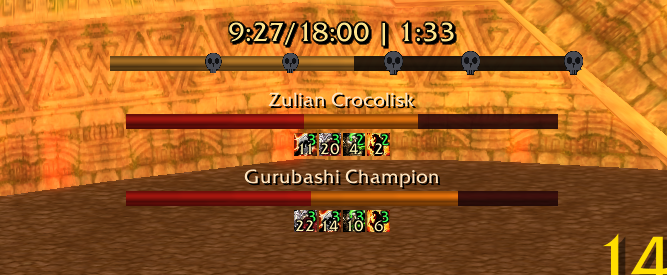

Upcoming bosses, and the gear they drop. A mark shows whether you already own that piece, based on the armory collection in the addon.

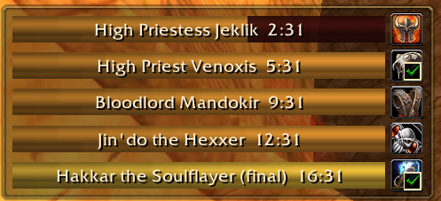

Kills, experience, and gold per minute, and how many enemies are alive.

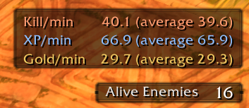

Guardian timers. Each row shows whether that guardian is alive, in combat, or how long until it returns.

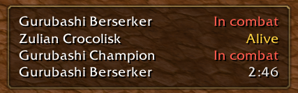

The options window. Each option can be turned on or off. Caches you can buy is under UI, just below kills, gold, and cache, and it starts on.

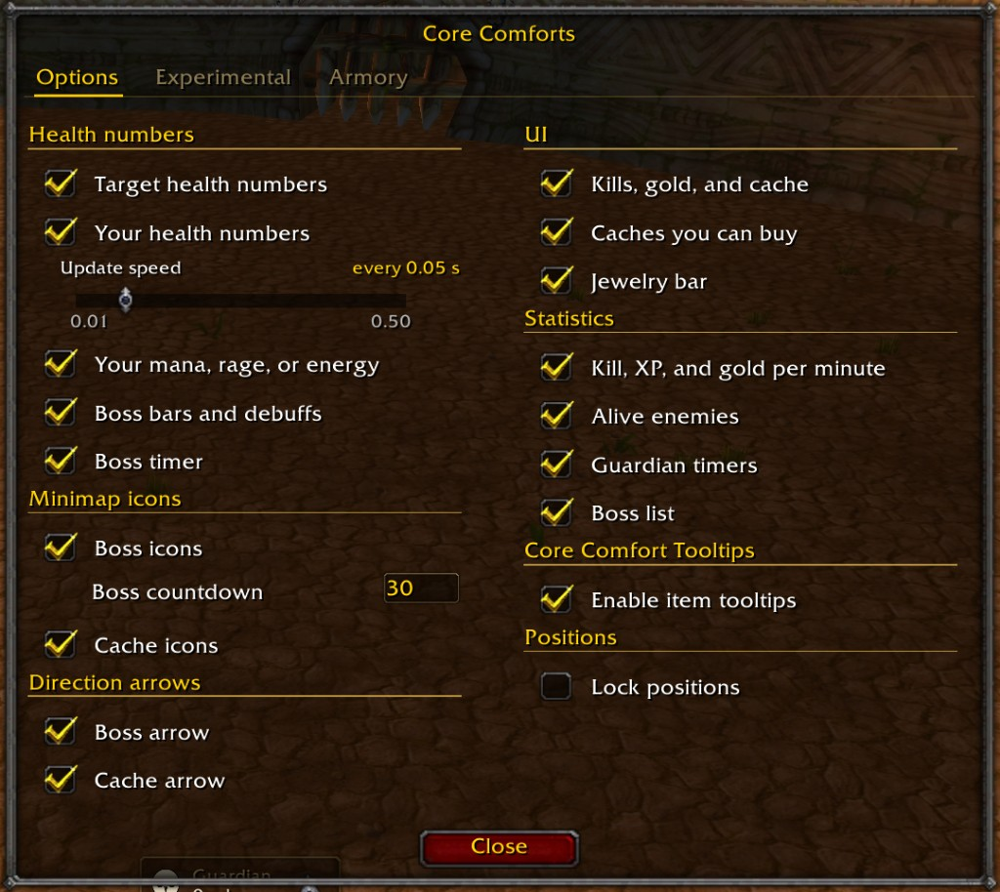

The armory. Gear from each map and boss. It updates when you get a drop. The addon cannot read your current collection, but you can edit the collection and check the items you already owned before installing it. It also shows your total marks, and the marks collected this run.

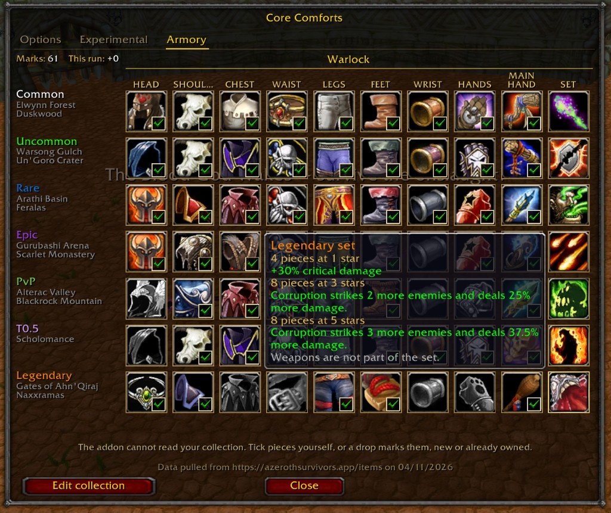

## Run History

Saves each run and compares kills per minute by class, map, difficulty, and spec. `/history` opens the window.

The run list. Filter by class, map, and difficulty. Switch between the full run and endless, and between the average pace and the last minute. The minimum length hides shorter runs, from 0 to 16 minutes.

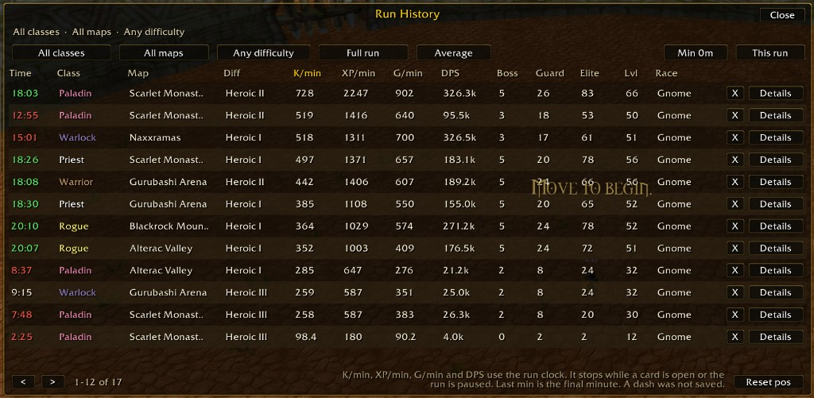

Details for one run. Kills, damage, gold, and the character's stats.

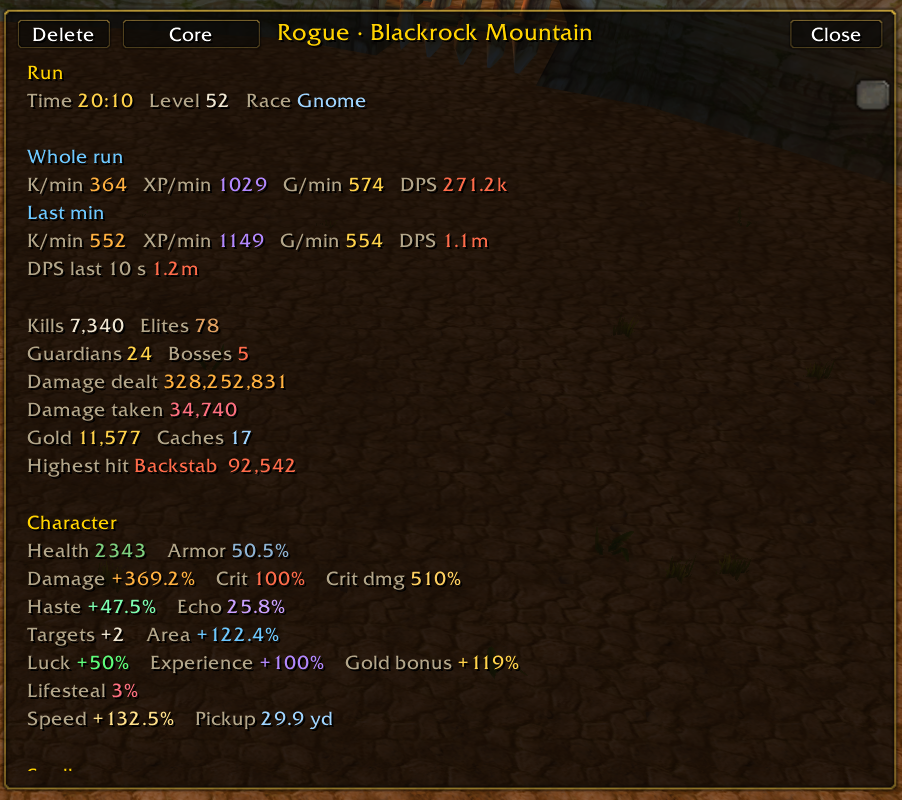

Spells, jewelry, and damage done.

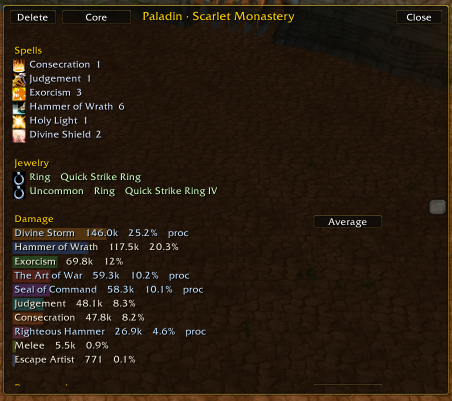

Damage for the last minute, damage taken, and pickups over time.

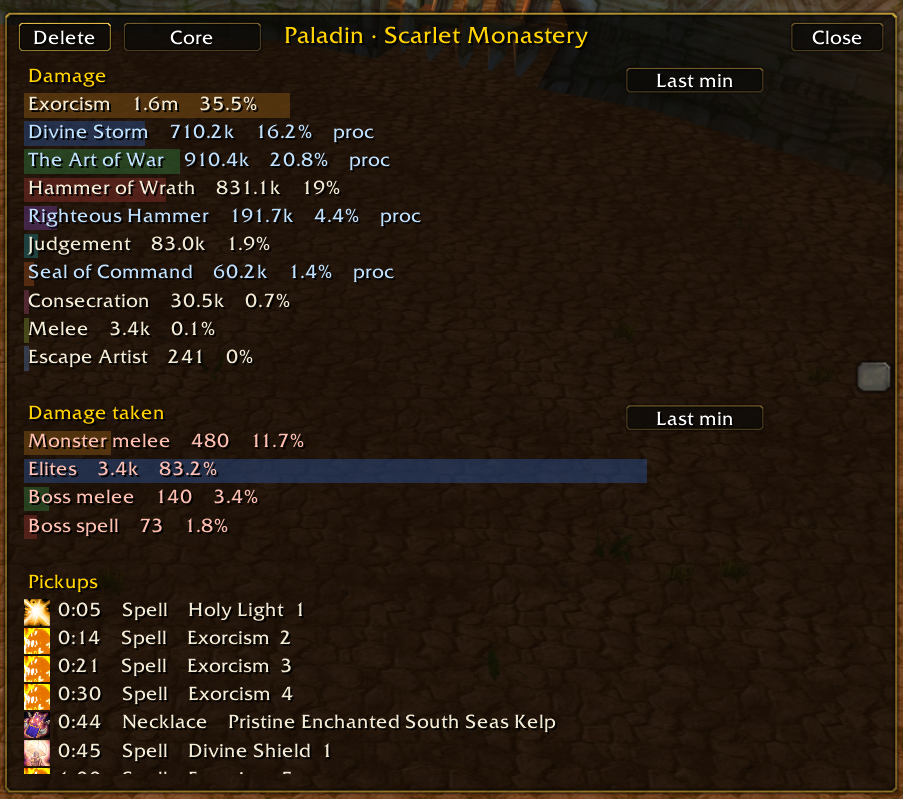

## Install

On Windows and Linux, copy the `CoreComforts` folder, the `RunHistory` folder, or both into `benilla-config/AddOns/` next to the game. The addons load on the next world entry.

In the browser client, open Options, then AddOns, and install a zip of one addon folder. The zip should contain that folder itself (`CoreComforts` or `RunHistory`), not an extra parent folder.

Saved settings stay on your computer. They are not part of this repository.
